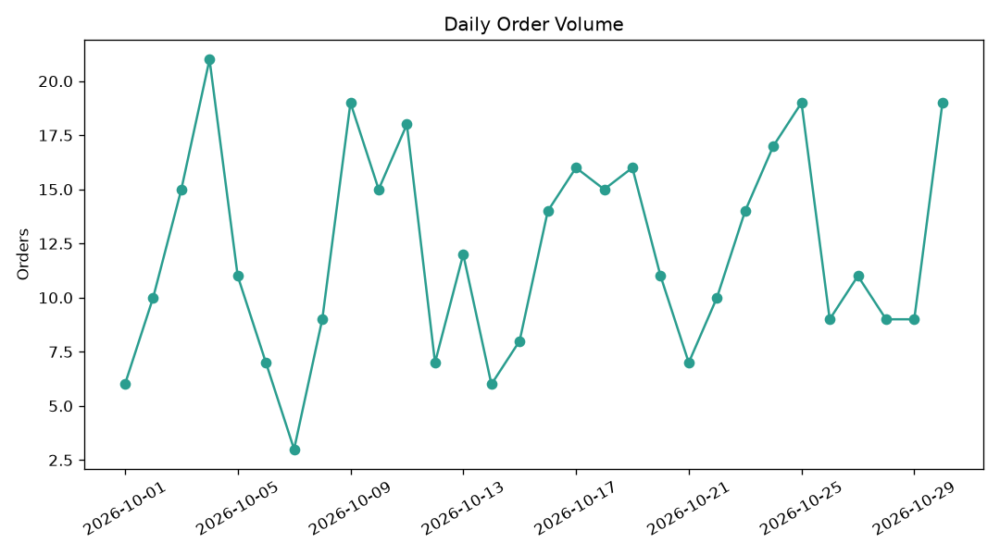
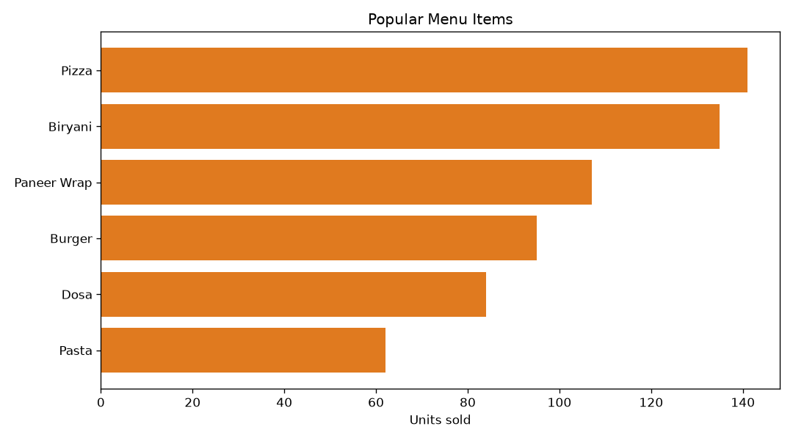
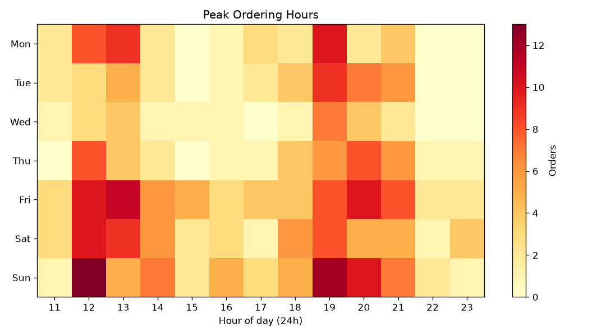
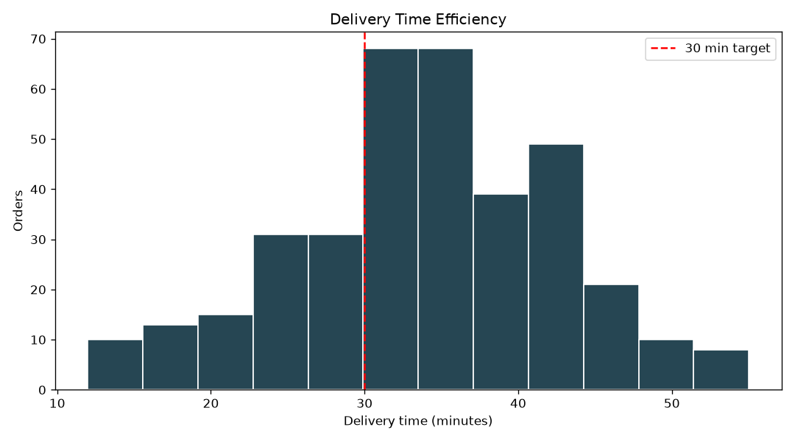

# Food Delivery Orders Analysis

This is my first data analysis project. I used Python (Pandas and Matplotlib) to look at food delivery orders and find some patterns.

The data is in `orders.csv`. It has 363 orders from October 2026. It is a sample dataset that I made for practice, not real company data.

## What I wanted to find out
- How many orders come in each day?
- Which food items sell the most?
- Which hours of the day are the busiest?
- How long do deliveries take?

## What I found
- Weekends have more orders (about 17 a day) than weekdays (about 10 a day)
- Pizza and Biryani sell the most
- The busiest hours are 7 PM, 12 PM and 1 PM
- Average delivery time is 34 minutes and only 34% of orders arrive within 30 minutes

## Charts
1. Line chart - daily orders

2. Horizontal bar chart - popular menu items

3. Heatmap - peak ordering hours

4. Histogram - delivery time

## How to run
Install the libraries, then run the code:

    pip install pandas matplotlib
    python analysis.py

## Files
- orders.csv - the data
- analysis.py - the code
- 4 png files - the charts the code creates
